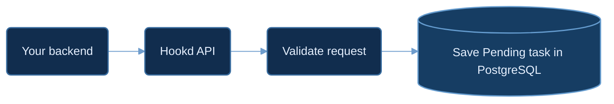
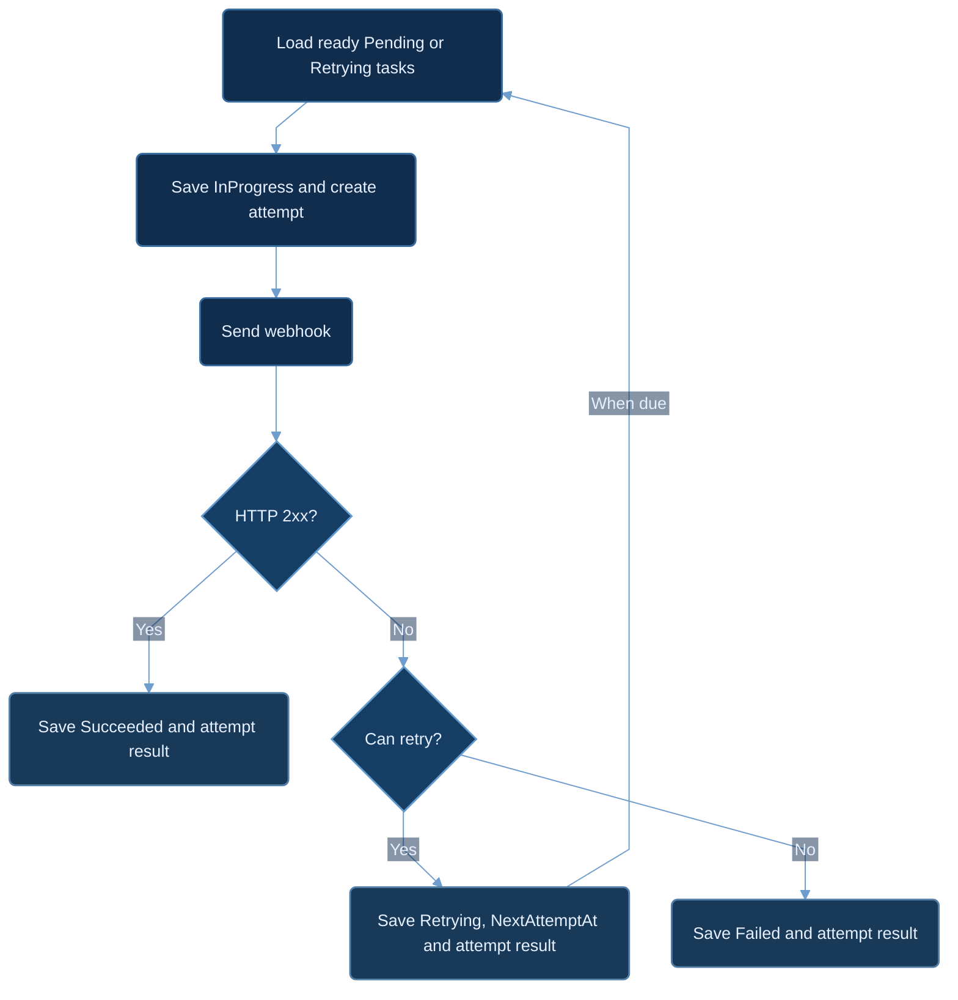

# Hookd

**Hookd (Hook Dispatcher)** is a self-hosted service for reliable HTTP webhook delivery. It accepts delivery tasks, stores them in a database, and sends them asynchronously through a background worker.

> **Work in progress.** The delivery pipeline is implemented;
> HTTP endpoints and failure recovery are still under development.

## Overview

Hookd handles outgoing webhook delivery **separately from the main application**.
Instead of sending an HTTP request and managing retries itself, the application
submits a delivery task to Hookd.

Tasks are stored in **PostgreSQL** and processed by a **background worker**.
Each delivery attempt is recorded with its result, response status and duration.
Temporary failures are **retried with a delay** until the attempt limit is reached.
Tasks can also be **scheduled for a later time**.

Hookd is designed to run as a **separate Docker container** on **your own infrastructure**.
Your backend submits delivery tasks through **Hookd's HTTP API**.

## How it works

**Task creation**

**Delivery**

The worker processes ready tasks in batches. When no tasks are ready, it waits for the configured idle delay before checking again.

Retries are scheduled for network errors, timeouts, and HTTP 408, 429 or 5xx
responses while attempts remain. Other unsuccessful responses or an exhausted
attempt limit result in a Failed task. The attempt limit includes the first delivery.

## Architecture & design patterns

The project follows **Clean Architecture**.

* **Domain:** Domain entities, repository interfaces and enums.
* **Persistence:** Repository implementations, entity configurations, migrations and `DbContext`.
* **Application:** Business logic, DTOs (requests and responses), services and their interfaces, custom exceptions, mapping (AutoMapper profiles) and validators (FluentValidation).
* **API:** Application hosting, HTTP endpoints, dependency injection, configuration and the background worker.

## Tech Stack

* **Framework**: .NET 10 / ASP.NET Core Web API
* **Database**: PostgreSQL
* **ORM**: Entity Framework Core (Code-First)
* **Object Mapping**: AutoMapper

## How to run
